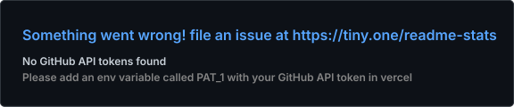

# Suhyun Park · 박수현

**Full-stack Developer**

### About · 소개

TypeScript is my preferred language. I build web apps and APIs with React, Next.js, and Node.js, and set up the infrastructure they run on. I enjoy connecting small pieces of code and ideas into services people can use.

TypeScript를 가장 선호하며, React와 Next.js, Node.js로 웹과 API를 만들고 인프라도 구축합니다. 작은 코드와 아이디어를 연결해 사람들이 사용할 수 있는 서비스로 만드는 일을 좋아합니다.

---

### Tech Stack · 사용 기술

**Languages · 언어**

    

**Frontend · 프론트엔드**

 

**Libraries & Styling · 라이브러리 및 스타일링**

   

**Backend · 백엔드**

   

**Databases · 데이터베이스**

    

**Infrastructure · 인프라**

    

**Design · 디자인**

**Development Tools · 개발 도구**

     

---

### GitHub Activity · 개발 활동

  
  

---

### Contact · 연락처

[23s607h0659@gmail.com](mailto:23s607h0659@gmail.com) · [Repositories · 저장소](https://github.com/psh-suhyun?tab=repositories)
